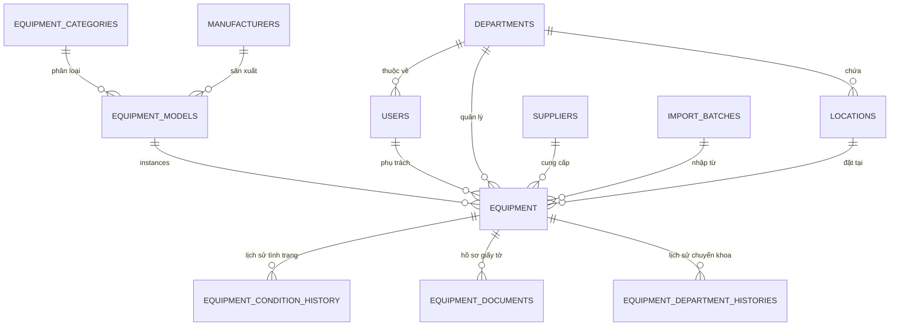

# MEMS — Hệ Thống Quản Lý Trang Thiết Bị Y Tế

Hệ thống quản lý tài sản, trang thiết bị y tế dành cho bệnh viện quy mô ~200 giường (~286 thiết bị theo Phụ lục 2).

Đang phát triển **Phase 1 (MVP)** — tập trung vào: danh mục thiết bị, phân quyền, nhập/xuất dữ liệu, tra cứu, tình trạng thiết bị, theo dõi hồ sơ giấy tờ, phân khoa.

> **Chưa triển khai (Phase 2+):** Bảo trì/sửa chữa, kiểm định/hiệu chuẩn, điều chuyển nâng cao, dashboard tổng hợp (hiện mới có dashboard cơ bản), mua sắm/kho vật tư, kế toán, AI/IoT.

---

## 🛠️ Công Nghệ

| Thành phần | Phiên bản |
|---|---|
| **Backend** | Laravel 13.x (PHP 8.3+) |
| **Frontend** | Livewire 4 + Alpine.js + Tailwind CSS v4 |
| **Database** | SQLite (dev/prod local) · SQLite in-memory (test) |
| **Phân quyền** | spatie/laravel-permission 8.x |
| **Excel Import/Export** | maatwebsite/excel 4.x (PhpSpreadsheet) |
| **PDF Export** | barryvdh/laravel-dompdf 3.x |
| **QR Code** | simplesoftwareio/simple-qrcode 4.x |

---

## 🚀 Cài Đặt & Khởi Chạy

### Yêu cầu
- PHP ≥ 8.3 (extensions: `pdo_sqlite`, `mbstring`, `openssl`, `gd`, `zip`)
- Composer ≥ 2.x
- Node.js ≥ 18.x & NPM

### Các bước

```bash
# 1. Cài PHP dependencies
composer install

# 2. Cài Node dependencies & build assets
npm install
npm run build

# 3. Tạo file .env (nếu chưa có) và cấu hình môi trường
cp .env.example .env
# - Cấu hình ngôn ngữ hệ thống tiếng Việt:
#   APP_LOCALE=vi
#   APP_FALLBACK_LOCALE=vi
# - Cấu hình APP_URL đúng địa chỉ IP hoặc tên miền cố định của máy chủ TRƯỚC KHI in nhãn:
#   APP_URL=http://192.168.1.100:8000
# - Cấu hình tên bệnh viện xuất hiện trên tiêu đề biên bản PDF:
#   APP_HOSPITAL_NAME="Bệnh viện Đa khoa MEMS"
# - Cấu hình thời gian sống phiên làm việc (phút, mặc định 120 phút):
#   SESSION_LIFETIME=120

# 4. Tạo Application Key
php artisan key:generate

# 5. Tạo CSDL & seed dữ liệu nền (19 khoa, 5 tài khoản, 0 thiết bị)
php artisan migrate:fresh --seed

# 6. Khởi chạy server
php artisan serve
# → Truy cập http://127.0.0.1:8000
```

### Seed dữ liệu demo (tùy chọn)

Khi muốn có thiết bị giả để xem giao diện & test tính năng:

```bash
php artisan db:seed --class=DemoMasterDataSeeder   # Danh mục mẫu (hãng, model, NCC...)
php artisan db:seed --class=DemoEquipmentSeeder     # ~110 thiết bị mẫu
```

### Nhập dữ liệu thật từ Phụ lục 2

```bash
# Bước 1: Chạy DRY-RUN — chỉ kiểm tra & tạo file CSV review, chưa ghi CSDL
php artisan equipment:import-pl2 data-real/PL2_TBYT.xlsx

# Bước 2: Xem file review tại storage/app/import-review/pl2_review.csv

# Bước 3: Khi đã sẵn sàng, chạy COMMIT ghi vào CSDL
php artisan equipment:import-pl2 data-real/PL2_TBYT.xlsx --commit
```

### Đối soát hồ sơ từ KQRS

```bash
php artisan equipment:reconcile-kqrs data-real/kqrs.xlsx
```

---

## 🔑 Tài Khoản Demo

Mật khẩu chung: `password`

| Vai trò | Email | Khoa | Quyền hạn chính |
|---|---|---|---|
| Quản trị hệ thống | `admin@mems.local` | — | Toàn quyền, soft-delete thiết bị (trang quản lý user chưa có) |
| Phòng Vật tư-TBYT | `vattu@mems.local` | — | CRUD thiết bị, import/export, quản lý danh mục (kiểm kê: dự kiến, chưa có) |
| Kỹ thuật viên | `kythuat@mems.local` | — | Xem thiết bị, cập nhật tình trạng kỹ thuật |
| Khoa sử dụng | `khoa@mems.local` | Khoa Nội (`KNOI`) | Chỉ xem thiết bị khoa mình, đề nghị xóa |
| Ban giám đốc | `giamdoc@mems.local` | — | Chỉ xem, xuất báo cáo (read-only) |

---

## 📋 Ma Trận Quyền

| Vai trò | Xem TB | Sửa TB | Xóa TB | Đổi tình trạng | Import/Export | Quản lý danh mục | Quản lý user |
|---|---|---|---|---|---|---|---|
| **admin** | Toàn bộ | ✓ | ✓ (Soft delete) | ✓ | ✓ | ✓ | ✓ (quyền đã seed, chưa có trang) |
| **equipment_dept** | Toàn bộ | ✓ | Đề nghị | ✓ | ✓ | ✓ | ✗ |
| **technician** | Toàn bộ | Chỉ tình trạng KT | ✗ | ✓ | ✗ | ✗ | ✗ |
| **using_dept** | Chỉ khoa mình | ✗ | Đề nghị (khoa mình) | ✗ | ✗ | ✗ | ✗ |
| **directorate** | Toàn bộ (read-only) | ✗ | ✗ | ✗ | Xuất báo cáo | ✗ | ✗ |

---

## 🗺️ Các Trang & URL

| URL | Trang | Quyền |
|---|---|---|
| `/login` | Đăng nhập | Guest |
| `/dashboard` | Trang chính | Tất cả user đã đăng nhập |
| `/equipment` | Danh sách thiết bị (lọc, tìm, phân trang) | `equipment.view` |
| `/equipment/create` | Thêm mới thiết bị | `equipment.create` |
| `/equipment/{id}` | Chi tiết thiết bị (hồ sơ, tài liệu, lịch sử tình trạng) | `equipment.view` |
| `/equipment/{equipment}/label` | In nhãn mã QR đơn lẻ cho thiết bị | `equipment.view` (Admin / Vật tư / KTV / BGĐ toàn viện; Khoa: khoa mình) |
| `/equipment/{id}/edit` | Sửa thiết bị | `equipment.edit` |
| `/equipment/import` | Import Excel 2 bước (preview → xác nhận) | `equipment.import` |
| `/equipment/unassigned` | Thiết bị Chưa phân khoa — gán khoa hàng loạt | Admin / Vật tư |
| `/departments/{department}/equipment-labels` | In nhãn QR danh sách thiết bị theo khoa | `equipment.view` (Admin / Vật tư / KTV / BGĐ; Khoa: khoa mình) |
| `/import-batches` | Lịch sử các đợt import | `equipment.import` |
| `/categories` | Quản lý danh mục (Loại TB, Hãng, Model, NCC, Vị trí) | `master_data.manage` |
| `/reports/documents` | Báo cáo tổng hợp hồ sơ giấy tờ theo khoa | Admin / Vật tư / BGĐ / Khoa |
| `/inventory` | Danh sách kỳ kiểm kê | `inventory.manage` (Admin / Vật tư / Khoa / Kỹ thuật viên) |
| `/inventory/{id}` | Chi tiết kỳ kiểm kê & Quét mã QR/nhập thủ công | `inventory.manage` (Phân quyền theo phạm vi khoa) |
| `/inventory/{session}/labels` | In nhãn QR hàng loạt theo kỳ kiểm kê | `inventory.manage` (Admin / Vật tư / KTV; Khoa: kỳ khoa mình; BGĐ: 403) |
| `/audit-logs` | Nhật ký hệ thống (Audit Log) lọc, tra cứu | `audit_log.view` (Admin / Vật tư / BGĐ) |

---

## 📁 Cấu Trúc Dự Án

```
ql_thietbi-main/
├── app/
│   ├── Console/Commands/
│   │   ├── DatabaseBackupCommand.php      # Sao lưu SQLite vào storage/app/backups
│   │   ├── GenerateSampleImportFile.php   # Sinh file Excel mẫu cho test import
│   │   ├── ImportPl2EquipmentCommand.php  # Import dữ liệu thật từ PL2 (dry-run/commit)
│   │   └── ReconcileKqrsCommand.php       # Đối soát hồ sơ từ KQRS với CSDL
│   │
│   ├── Enums/
│   │   ├── DocumentStatusEnum.php         # Có / Không / Không áp dụng / Chưa rà soát
│   │   ├── DocumentTypeEnum.php           # 15 loại hồ sơ giấy tờ
│   │   ├── EquipmentConditionEnum.php     # Đang hoạt động → Hỏng → Ngừng SD
│   │   ├── EquipmentStatusEnum.php        # Đang sử dụng / Dự phòng / Thanh lý / Đã thanh lý
│   │   ├── InventoryItemResultEnum.php    # Kết quả kiểm: Khớp / Thiếu / Thừa / Hỏng
│   │   ├── InventorySessionStatusEnum.php # Đang kiểm kê / Đã hoàn thành
│   │   └── OwnershipTypeEnum.php          # Mua sắm / Máy đặt / Mượn / Tài trợ
│   │
│   ├── Exports/
│   │   ├── DocumentReportExport.php       # Xuất Excel báo cáo hồ sơ
│   │   └── EquipmentExport.php            # Xuất danh sách thiết bị Excel/CSV
│   │
│   ├── Http/
│   │   ├── Controllers/
│   │   │   └── EquipmentLabelController.php # In nhãn QR Code (đơn lẻ, theo kỳ, theo khoa)
│   │   └── Middleware/
│   │       └── CheckDepartmentScope.php   # Giới hạn Khoa chỉ xem TB khoa mình
│   │
│   ├── Imports/
│   │   └── EquipmentSheetImport.php       # Đọc file Excel import (ToArray + HeadingRow)
│   │
│   ├── Livewire/
│   │   ├── AuditLogs/
│   │   │   └── AuditLogIndex.php          # Nhật ký hệ thống Livewire
│   │   ├── Auth/Login.php
│   │   ├── Equipment/
│   │   │   ├── EquipmentIndex.php         # Danh sách + lọc + tìm + xuất Excel/CSV/PDF
│   │   │   ├── EquipmentCreate.php        # Form thêm mới
│   │   │   ├── EquipmentEdit.php          # Form chỉnh sửa
│   │   │   ├── EquipmentShow.php          # Chi tiết + cập nhật tình trạng + hồ sơ
│   │   │   ├── EquipmentImport.php        # Import Excel 2 bước
│   │   │   └── EquipmentUnassigned.php    # Gán khoa cho TB chưa phân khoa
│   │   ├── ImportBatches/
│   │   │   └── ImportBatchIndex.php       # Lịch sử import
│   │   ├── Inventory/
│   │   │   ├── InventoryIndex.php         # Danh sách & tạo kỳ kiểm kê (snapshot thiết bị)
│   │   │   └── InventoryShow.php          # Quét camera QR / nhập mã, chốt kỳ
│   │   ├── MasterDataIndex.php            # Quản lý 5 bảng danh mục (tabs)
│   │   └── Reports/
│   │       └── DocumentReportIndex.php    # Báo cáo tổng hợp hồ sơ
│   │
│   ├── Models/
│   │   ├── AuditLog.php                   # Nhật ký hệ thống (Append-only)
│   │   ├── Department.php                 # Khoa / Phòng (19 đơn vị)
│   │   ├── Equipment.php                  # Thiết bị (asset)
│   │   ├── EquipmentCategory.php          # Loại thiết bị
│   │   ├── EquipmentConditionHistory.php  # Lịch sử thay đổi tình trạng
│   │   ├── EquipmentDepartmentHistory.php # Lịch sử gán/chuyển khoa
│   │   ├── EquipmentDocument.php          # Hồ sơ giấy tờ kèm theo TB
│   │   ├── EquipmentModel.php             # Model thiết bị (VD: Philips MX450)
│   │   ├── ImportBatch.php                # Đợt import (file, kết quả, lỗi)
│   │   ├── InventoryItem.php              # Từng mục kiểm kê trong kỳ
│   │   ├── InventorySession.php           # Kỳ kiểm kê
│   │   ├── Location.php                   # Vị trí lắp đặt
│   │   ├── Manufacturer.php               # Hãng sản xuất
│   │   ├── Supplier.php                   # Nhà cung cấp
│   │   └── User.php
│   │
│   ├── Policies/
│   │   ├── EquipmentPolicy.php            # Phân quyền CRUD + import/export
│   │   └── EquipmentDocumentPolicy.php    # Phân quyền hồ sơ
│   │
│   └── Services/
│       ├── EquipmentConditionService.php  # Service cập nhật tình trạng & ghi lịch sử
│       └── EquipmentImportValidator.php   # Validate từng dòng Excel (pre-load, N+1 safe)
│
├── database/
│   ├── factories/                         # 9 factories (Equipment, Model, Manufacturer...)
│   ├── migrations/                        # 18 migrations
│   │   ├── ...create_users_table
│   │   ├── ...create_permission_tables    # Spatie roles & permissions
│   │   ├── ...create_departments_table
│   │   ├── ...create_equipment_categories_table
│   │   ├── ...create_manufacturers_table
│   │   ├── ...create_equipment_models_table
│   │   ├── ...create_suppliers_table
│   │   ├── ...create_locations_table
│   │   ├── ...create_equipment_table
│   │   ├── ...create_import_batches_table
│   │   ├── ...create_equipment_condition_history_table
│   │   ├── ...update_equipment_and_create_equipment_documents_table
│   │   └── ...create_equipment_department_histories_table
│   └── seeders/
│       ├── DatabaseSeeder.php             # Gọi 3 seeder nền (khoa, quyền, user)
│       ├── DepartmentSeeder.php           # 16 khoa lâm sàng + 3 đơn vị hệ thống
│       ├── RolePermissionSeeder.php       # 12 permissions + 5 roles
│       ├── UserSeeder.php                 # 5 tài khoản demo
│       ├── DemoMasterDataSeeder.php       # Hãng, model, NCC, vị trí (demo)
│       └── DemoEquipmentSeeder.php        # ~110 thiết bị giả (demo)
│
├── data-real/                             # ⛔ Gitignored — File Excel dữ liệu thật
│   ├── PL2_TBYT.xlsx                      # Phụ lục 2 — danh sách thiết bị
│   └── kqrs.xlsx                          # Kết quả rà soát hồ sơ
│
├── resources/views/
│   ├── components/layouts/
│   │   ├── app.blade.php                  # Layout chính (sidebar + topbar)
│   │   └── guest.blade.php                # Layout trang login
│   ├── livewire/                          # Blade cho từng Livewire component
│   ├── pdf/
│   │   ├── equipment_list.blade.php       # Template xuất PDF danh sách
│   │   └── equipment_profile.blade.php    # Template xuất PDF hồ sơ 1 TB
│   └── dashboard.blade.php
│
├── routes/web.php                         # Toàn bộ route definitions
├── scratch/                               # Script PHP tạm (inspect, debug)
├── tests/
│   ├── Feature/                           # 12 feature test files
│   └── Unit/                              # 1 unit test file
│
├── implementation_plan.md                 # Kế hoạch Module 2
├── plan-module3-import-export.md          # Kế hoạch Module 3
├── prompt-phase1-MEMS.md                  # Prompt gốc mô tả toàn bộ Phase 1
└── walkthrough.md                         # Báo cáo hoàn thành Module 2
```

---

## 📊 Schema Database



### Các bảng chính

| Bảng | Mô tả | Số bản ghi mẫu |
|---|---|---|
| `departments` | 16 khoa lâm sàng + 3 đơn vị hệ thống | 19 |
| `equipment` | Từng thiết bị vật lý (serial, mã, vị trí, tình trạng) | ~286 (thật) / ~110 (demo) |
| `equipment_models` | Model thiết bị (VD: Philips IntelliVue MX450) | Tự động tạo khi import |
| `equipment_categories` | Loại (Máy thở, Monitor, Siêu âm...) | — |
| `manufacturers` | Hãng sản xuất (Philips, GE, Mindray...) | — |
| `suppliers` | Nhà cung cấp | — |
| `locations` | Vị trí lắp đặt (tòa nhà, tầng, phòng) | — |
| `import_batches` | Lịch sử import: file, kết quả, lỗi | — |
| `equipment_documents` | 15 loại hồ sơ giấy tờ cho mỗi TB (Có/Không/Chưa RS) | — |
| `equipment_condition_history` | Log mỗi lần đổi tình trạng kỹ thuật | — |
| `equipment_department_histories` | Log mỗi lần gán/chuyển khoa | — |
| `inventory_sessions` | Các đợt / kỳ kiểm kê (khoa hoặc toàn viện) | — |
| `inventory_items` | Danh sách thiết bị kiểm đếm theo kỳ (khớp, thiếu, thừa, hỏng) | — |
| `audit_logs` | Nhật ký hệ thống append-only (chặn UPDATE/DELETE qua trigger SQLite) | — |

---

## 🏷️ Các Enum Quan Trọng

### Tình trạng kỹ thuật (`EquipmentConditionEnum`)
| Giá trị | Nhãn |
|---|---|
| `dang_hoat_dong` | Đang hoạt động |
| `can_theo_doi` | Cần theo dõi |
| `can_bao_tri` | Cần bảo trì |
| `hong` | Hỏng |
| `ngung_su_dung` | Ngừng sử dụng |

### Trạng thái quản lý (`EquipmentStatusEnum`)
| Giá trị | Nhãn |
|---|---|
| `dang_su_dung` | Đang sử dụng |
| `du_phong` | Dự phòng |
| `thanh_ly` | Đề nghị thanh lý |
| `da_thanh_ly` | Đã thanh lý |

### Hình thức sở hữu (`OwnershipTypeEnum`)
| Giá trị | Nhãn |
|---|---|
| `mua_sam` | Mua sắm |
| `may_dat` | Máy đặt của nhà cung cấp |
| `muon` | Mượn |
| `tai_tro` | Tài trợ |

### Loại hồ sơ (`DocumentTypeEnum`) — 15 loại
Hợp đồng/hóa đơn, Biên bản bàn giao, Hồ sơ lưu hành, CO, CQ, Tờ khai hải quan, Tài liệu kỹ thuật/HDSD, Công bố ĐK mua bán, Lý lịch, Nhật ký sử dụng, Quy trình vận hành, Hồ sơ bảo dưỡng, Hồ sơ điều chuyển/thanh lý, Kiểm định, Hiệu chuẩn.

### Trạng thái hồ sơ (`DocumentStatusEnum`)
`co` · `khong` · `khong_ap_dung` · `chua_ra_soat`

---

## 🧪 Chạy Kiểm Thử

```bash
php artisan test              # Toàn bộ test suite
php artisan test --filter=EquipmentCrudTest   # Chạy 1 file test cụ thể
```

Test chạy trên SQLite in-memory, độc lập với database dev.

### Danh sách test files

| File | Mô tả |
|---|---|
| `AuthTest` | Đăng nhập, đăng xuất, sai mật khẩu, scope khoa |
| `EquipmentCrudTest` | CRUD theo 5 vai trò (admin, vattu, kythuat, khoa, giamdoc) |
| `EquipmentImportTest` | Import Excel 2 bước, phân quyền import |
| `EquipmentIndexFiltersTest` | Bộ lọc, tìm kiếm, phân trang |
| `EquipmentUnassignedTest` | Gán khoa hàng loạt |
| `ConditionHistoryTest` | Đổi tình trạng → ghi lịch sử |
| `DocumentReportTest` | Báo cáo tổng hợp hồ sơ |
| `MasterDataManagementTest` | CRUD danh mục (loại, hãng, model, NCC, vị trí) |
| `EquipmentRealDataSchemaTest` | Kiểm tra schema phù hợp dữ liệu thật |
| `EquipmentShowDocumentTabTest` | Tab hồ sơ giấy tờ trong trang chi tiết |
| `ImportPl2EquipmentCommandTest` | Command import PL2 (dry-run/commit) |
| `ReconcileKqrsCommandTest` | Command đối soát KQRS |
| `EquipmentImportValidatorTest` | Unit test validator import |
| `AuditLogTest` | Kiểm thử Audit Log: phân quyền 5 vai trò, append-only exception, SQLite trigger, observer không lộ password/token, Livewire filters, artisan db:backup |
| `InventoryTest` | Kiểm thử Module 6a: phân quyền 5 vai trò (BGĐ 403, KTV chỉ quét không tạo/chốt, Khoa chỉ theo khoa mình), snapshot loại bỏ đã thanh lý, quét khớp/thừa/trùng/mã sai/ngoài phạm vi, báo hỏng không đổi tình trạng với user thiếu quyền, chốt kỳ chuyển thiếu và khóa server-side |
| `EquipmentLabelTest` | Kiểm thử Module 6b: in nhãn QR đơn lẻ, in theo kỳ kiểm kê, in theo khoa; phân quyền 5 vai trò (BGĐ in đơn lẻ/khoa 200, in kỳ 403; Khoa chỉ in khoa mình 403 khoa khác/toàn viện; KTV in toàn viện; User không khoa 403 cả 3 route; loại bỏ đã thanh lý & item thừa khoa khác; SVG không chứa `<?xml`) |
| `InventoryReportTest` | Kiểm thử Module 6c: báo cáo đối soát & xuất biên bản kiểm kê PDF/Excel; phân quyền 5 vai trò (BGĐ 403, Khoa chỉ khoa mình 403 khoa khác/toàn viện, User không khoa 403); xuất PDF 200 header application/pdf và tiếng Việt font DejaVu Sans; kỳ đang mở có watermark/chữ "Chưa chốt"; kỳ completed là biên bản chính thức; khớp số liệu thống kê; không lộ thiết bị thừa khoa khác cho using_dept |
| `EquipmentScanTest` | Kiểm thử Module 6d: quét QR điện thoại mở thẻ máy (`/q/{code}`), khách chuyển tới login và không rò rỉ dữ liệu máy, sau login chuyển về đúng intended URL, 404 mã không tồn tại, mã ký tự đặc biệt/khoảng trắng, phân quyền xem (khoa chỉ máy mình, khoa khác 403, BGĐ xem được), không hiển thị giá mua/nguồn kinh phí, nút Đổi tình trạng chỉ cho người có quyền updateCondition, nhãn in chứa full URL và dòng chữ `/q/{code}`, màn kiểm kê nhận cả URL lẫn mã thô, ghi nhớ đăng nhập mặc định, giao diện dùng mobile layout gọn không có aside, route khai báo duy nhất |
| `UserManagementTest` | Kiểm thử Quản lý người dùng: phân quyền 5 vai trò (chỉ admin truy cập), validation using_dept bắt buộc khoa, khóa/mở khóa tài khoản, người bị khóa không đăng nhập được và hủy phiên hiện tại, chặn tự hại (tự khóa/xóa/gỡ quyền admin) và bảo vệ admin cuối cùng, đặt lại mật khẩu, xóa mềm không lỗi audit log, đổi mật khẩu cá nhân |
| `ValidationLocaleTest` | Kiểm thử ngôn ngữ thông báo validate tiếng Việt (`APP_LOCALE=vi`) |
| `SmokeTest` | Smoke test toàn diện: mọi route web cho từng vai trò trong 5 vai trò không bao giờ trả về lỗi 500 (200/403/302) |

---

## 📦 Artisan Commands Tùy Chỉnh

| Command | Mô tả |
|---|---|
| `equipment:import-pl2 {file} [--commit]` | Import thiết bị từ file Phụ lục 2. Mặc định DRY-RUN (chỉ tạo CSV review). Thêm `--commit` để ghi CSDL. Idempotent (chạy lại an toàn). |
| `equipment:reconcile-kqrs {file}` | Đối soát hồ sơ giấy tờ từ KQRS với dữ liệu trong CSDL. Chỉ đọc, không thay đổi dữ liệu. |
| `app:generate-sample-import` | Sinh file Excel mẫu để test tính năng Import qua giao diện web. |
| `db:backup [--keep=N]` | Sao lưu cơ sở dữ liệu SQLite vào `storage/app/backups` kèm timestamp, tự động giữ N bản sao lưu mới nhất (mặc định 5). |

---

## 📝 Tiến Độ Phát Triển Phase 1

| # | Module | Trạng thái |
|---|---|---|
| 1 | Đăng nhập & Phân quyền | ✅ Hoàn thành |
| 2 | Danh mục & Quản lý Thiết bị | ✅ Hoàn thành |
| 3 | Nhập/Xuất dữ liệu (Import Excel / Export) | ✅ Hoàn thành |
| — | Import dữ liệu thật PL2 + Đối soát KQRS | ✅ Hoàn thành |
| — | Hồ sơ giấy tờ thiết bị (15 loại) | ✅ Hoàn thành |
| — | Gán khoa hàng loạt cho TB chưa phân khoa | ✅ Hoàn thành |
| — | Báo cáo tổng hợp hồ sơ theo khoa | ✅ Hoàn thành |
| — | Lịch sử chuyển khoa | ✅ Hoàn thành |
| 4 | Tra cứu thiết bị (full-text, bộ lọc nâng cao) | 🔶 Cơ bản xong (đã có lọc/tìm/sắp xếp/phân trang trong EquipmentIndex) |
| 5 | Tình trạng thiết bị & lịch sử | 🔶 Cơ bản xong (đã có bảng condition_history, cập nhật từ EquipmentShow) |
| 6 | Kiểm kê thiết bị (QR Code, kỳ kiểm kê) | ✅ Hoàn thành (6a: Kỳ kiểm kê & quét mã; 6b: In nhãn QR Code A4; 6c: Báo cáo đối soát & biên bản kiểm kê PDF/Excel; 6d: Quét QR điện thoại mở thẻ máy) |
| 7 | Audit Log & Hệ thống (append-only log, backup) | ✅ Hoàn thành |
| 8 | Quản lý Người dùng & Đổi mật khẩu | ✅ Hoàn thành (`/users` cho admin, `/profile/password` cho cá nhân) |

---

## ⚠️ Lưu Ý Quan Trọng

- **Cấu hình APP_URL & Quét QR bằng điện thoại (Module 6d):**
  - **Đặt `APP_URL` cố định**: Cần thiết lập biến `APP_URL` trong file `.env` thành địa chỉ IP tĩnh hoặc tên miền của máy chủ bệnh viện (ví dụ `http://192.168.1.50:8000` hoặc `https://mems.benhvien.vn`) **TRƯỚC KHI** in nhãn thiết bị. Nhãn in chứa đường dẫn URL đầy đủ dạng `rtrim(config('app.url'), '/') . '/q/' . rawurlencode($equipment->code)`. Kích thước QR khi in tối thiểu khoảng 25mm để camera điện thoại lấy nét tốt nhất.
  - **Nhãn cũ (mã thô) vs Nhãn mới (đường dẫn)**: Màn hình quét kiểm kê (`InventoryShow`) và camera web hỗ trợ song song cả hai dạng payload: nếu quét được đường dẫn `.../q/{code}` thì tự động tách lấy `{code}`, nếu quét mã thô truyền thống thì sử dụng trực tiếp. Nhãn in kiểu cũ vẫn hoàn toàn hoạt động bình thường.
  - **Bắt buộc đăng nhập & Bảo mật**: BẮT BUỘC phải đăng nhập mới xem được thông tin máy (không có trang công khai). Khách quét mã khi chưa đăng nhập sẽ chuyển hướng sang trang đăng nhập, sau khi đăng nhập thành công sẽ tự động quay trở lại đúng trang `/q/{code}` của máy đó (nhờ cơ chế intended). Trang đăng nhập hoàn toàn không làm lộ tên máy hay bất kỳ thông tin nào của máy.
  - **Phân quyền Thẻ thiết bị di động (`/q/{code}`)**: Khoa sử dụng chỉ xem được máy thuộc khoa mình (khoa khác trả về 403 Forbidden); Ban Giám đốc xem được toàn viện; Kỹ thuật viên và Quản trị viên có thêm nút "Đổi Tình Trạng Thiết Bị" lớn, dễ bấm trên màn hình điện thoại để cập nhật tình trạng kỹ thuật và lưu vết lịch sử. Thẻ thiết bị di động tuyệt đối **không hiển thị giá mua (`purchase_price`) và nguồn kinh phí (`funding_source`)**.
  - **Môi trường mạng & HTTPS**: Điện thoại cần kết nối vào mạng nội bộ (Wi-Fi bệnh viện) để vào được máy chủ. Quét link bằng ứng dụng Camera mặc định của điện thoại thông minh (iOS/Android) **không yêu cầu HTTPS** (chỉ cần truy cập được HTTP của máy chủ). Tuy nhiên, tính năng mở Camera quét trực tiếp trên trang kiểm kê (`/inventory/{session}`) yêu cầu kết nối bảo mật **HTTPS** hoặc **localhost** do quy định bảo mật của các trình duyệt web.
  - **Cấu hình phiên làm việc (`SESSION_LIFETIME`)**: Mặc định là `120` phút (2 giờ) và ô "Ghi nhớ đăng nhập" được chọn sẵn trên màn hình đăng nhập.
    - *Cách chỉnh*: Thiết lập `SESSION_LIFETIME=240` (hoặc số phút mong muốn) trong `.env`.
    - *Khuyến nghị*: Đặt từ 120 đến 480 phút (2 - 8 tiếng) phù hợp với một ca trực hoặc ca đi kiểm kê của nhân viên.
    - *Đánh đổi bảo mật*: Thời gian phiên dài giúp nhân viên đi quét mã kiểm kê không bị gián đoạn vì hết phiên; tuy nhiên nếu điện thoại/máy tính bảng dùng chung hoặc bị thất lạc mà không khóa màn hình thì nguy cơ truy cập trái phép tăng lên.
- **Quản lý Người dùng (`/users`):** Chỉ Quản trị hệ thống (`admin`) có quyền truy cập. Hỗ trợ tạo, sửa, phân 5 vai trò, gán khoa, khóa/mở khóa tài khoản, đặt lại mật khẩu và xóa mềm. Có cơ chế chặn tự hại (admin không tự khóa/xóa/hạ quyền chính mình) và bảo vệ admin cuối cùng. Mọi người dùng đã đăng nhập đều có thể đổi mật khẩu cá nhân tại `/profile/password`.
- **Phân quyền In nhãn QR & Báo cáo kiểm kê:** Áp dụng nghiêm ngặt theo `EquipmentPolicy::view` và scope kiểm kê. Ban Giám đốc (`directorate`) có quyền xem toàn viện nên được phép in nhãn đơn lẻ và nhãn theo khoa (`200 OK`) phục vụ giám sát; tuy nhiên Ban Giám đốc không có quyền kiểm kê nên route in nhãn theo kỳ (`/inventory/{session}/labels`), xem báo cáo đối soát (`/inventory/{session}/report`), xuất PDF (`/inventory/{session}/export-pdf`) và xuất Excel (`/inventory/{session}/export-excel`) đều trả về `403 Forbidden`. Khoa sử dụng (`using_dept`) chỉ được truy cập kỳ kiểm kê và in nhãn thiết bị thuộc khoa mình (khoa khác hoặc kỳ toàn viện trả về `403 Forbidden`).
- **Biên bản kiểm kê PDF & Excel (Module 6c):** Sử dụng font `DejaVu Sans` cho tài liệu PDF tiếng Việt có dấu. Tên bệnh viện đọc từ biến `APP_HOSPITAL_NAME` (config `app.hospital_name`). Kỳ kiểm kê đang thực hiện (`in_progress`) hiển thị watermark và chữ "Chưa chốt" / "DỰ THẢO - CHƯA CHỐT" và chỉ coi là bản tạm tính; khi kỳ đã chốt (`completed`), biên bản xuất ra là biên bản chính thức đã khóa số liệu. Toàn bộ thiết bị thừa hoặc ngoài phạm vi được lọc bảo mật theo `EquipmentPolicy::view` tránh rò rỉ thông tin máy khoa khác.
- **Tính năng Kiểm kê (`/inventory`) & Quét QR:** Đã hoạt động đầy đủ trên thanh điều hướng. Trình duyệt yêu cầu môi trường **localhost** hoặc kết nối bảo mật **HTTPS** để cấp quyền truy cập Camera. Bên cạnh camera, hệ thống luôn hỗ trợ ô nhập mã thiết bị thủ công.
- **Dữ liệu thật** nằm trong `data-real/` — đã được `.gitignore` bảo vệ. **KHÔNG** chép tên người, số điện thoại từ file thật vào seeder, test, log hay commit.
- **Mọi thay đổi schema** phải là **migration mới** — không sửa migration cũ đã chạy.
- Sau mỗi thay đổi, chạy `php artisan migrate:fresh --seed` và `php artisan test` để xác nhận (hiện tại PASS 100% 196/196 tests).
- Code style: chạy `vendor/bin/pint --dirty` để format PHP theo chuẩn dự án.
