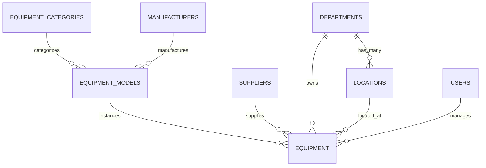

# Kế hoạch Triển khai Module 2 — Danh mục & Quản lý Trang thiết bị Y tế (Cập nhật sau Review)

Hệ thống Quản lý Trang thiết bị Y tế cho bệnh viện ~200 giường, ~1.000 thiết bị.

---

## Xác nhận Trạng thái Module 1 & Môi trường

> [!IMPORTANT]
> **Xác nhận 3 điểm từ review Module 1 đã áp dụng 100% vào code thật:**
> 1. **Middleware Aliases**: Đã đăng ký `role`, `permission`, `role_or_permission` của Spatie trong `bootstrap/app.php`.
> 2. **Vite Assets**: Đã thay Tailwind CDN bằng `@vite(['resources/css/app.css', 'resources/js/app.js'])` trong cả 2 layout `guest.blade.php` và `app.blade.php`. Đã npx build thành công manifest.
> 3. **Tài liệu README & Testing**: Đã cập nhật `README.md` với tài khoản demo, ma trợ quyền. `php artisan test` đạt **100% Pass** (8/8 tests).

---

## Tiếp thu & Cập nhật Chi tiết Kế hoạch Module 2

### 1. Phân quyền & Lọc Thiết bị theo Khoa (`using_dept` / `khoa`)
- **`EquipmentIndex` (Livewire)**:
  - Khi user có role `using_dept` (`Khoa sử dụng`), query danh sách tự động append: `->where('department_id', auth()->user()->department_id)`.
- **`EquipmentPolicy`**:
  - `view(User $user, Equipment $equipment)`: Nếu user có role `using_dept`, kiểm tra `$equipment->department_id === $user->department_id`. Nếu khác khoa → trả về `false` (Response 403 Forbidden khi truy cập trực tiếp URL `/equipment/{id}`).
  - `update(User $user, Equipment $equipment)`: Tương tự, Khoa sử dụng không được sửa thiết bị.
  - `requestDelete(User $user, Equipment $equipment)`: Cho phép cả `equipment_dept` (`vattu`) và `using_dept` (`khoa`). Đối với `using_dept`, phải thuộc khoa mình (`$equipment->department_id === $user->department_id`).

### 2. Thứ tự Migration cho `import_batch_id`
- Trong migration `create_equipment_table` của Module 2: Chỉ khai báo cột thô `$table->unsignedBigInteger('import_batch_id')->nullable();` (chưa dùng `constrained('import_batches')`).
- Ở Module 3 (khi tạo bảng `import_batches`), mới thêm migration phụ add FK constraint để tránh lỗi missing table khi chạy `php artisan migrate`.

### 3. Người phụ trách: Dùng `manager_id` (FK → `users`) + `manager_name` (Text fallback)
- Cột trong `equipment`:
  - `manager_id`: `$table->foreignId('manager_id')->nullable()->constrained('users')->nullOnDelete();`
  - `manager_name`: `$table->string('manager_name')->nullable();` (tên hiển thị / fallback)

### 4. Chuẩn hóa `EquipmentStatusEnum` đúng phạm vi Phase 1
Giữ đúng 4 trạng thái đơn giản, tránh chồng chéo với quy trình bảo trì/sửa chữa của Phase 2:
- `dang_su_dung`: Đang sử dụng
- `du_phong`: Dự phòng
- `thanh_ly`: Đề nghị thanh lý
- `da_thanh_ly`: Đã thanh lý

### 5. Test suite theo vai trò (`EquipmentCrudTest`)
Bổ sung đầy đủ test case phân quyền theo vai trò:
1. `test_admin_can_crud_and_soft_delete_equipment()`
2. `test_vattu_can_create_update_and_request_delete_equipment_but_cannot_soft_delete()`
3. `test_kythuat_can_only_update_equipment_condition()`
4. `test_khoa_user_can_only_view_and_request_delete_own_department_equipment()`
5. `test_khoa_user_cannot_view_or_access_other_department_equipment_by_url()`
6. `test_giamdoc_has_read_only_access_without_mutation_actions()`

---

## Schema Migration Chi tiết cho Module 2



### 1. `create_equipment_categories_table`
- `id`, `code` (unique), `name`, `description`, `timestamps`, `softDeletes`

### 2. `create_manufacturers_table`
- `id`, `code` (unique), `name`, `country`, `website`, `timestamps`, `softDeletes`

### 3. `create_equipment_models_table`
- `id`, `code` (unique), `name`, `category_id` (FK), `manufacturer_id` (FK), `specs` (text/json), `timestamps`, `softDeletes`

### 4. `create_suppliers_table`
- `id`, `code` (unique), `name`, `phone`, `email`, `address`, `timestamps`, `softDeletes`

### 5. `create_locations_table`
- `id`, `code` (unique), `name`, `department_id` (FK), `building`, `floor`, `room`, `timestamps`, `softDeletes`

### 6. `create_equipment_table`
- `id`, `code` (unique), `name`
- `equipment_model_id` (FK -> equipment_models)
- `category_id` (FK -> equipment_categories)
- `manufacturer_id` (FK -> manufacturers)
- `serial_number` (string, unique)
- `manufacture_year` (integer, nullable)
- `origin_country` (string, nullable)
- `import_date` (date, nullable)
- `usage_start_date` (date, nullable)
- `purchase_price` (decimal 15,2, default 0)
- `funding_source` (string, nullable)
- `supplier_id` (FK -> suppliers, nullable)
- `warranty_expiration_date` (date, nullable)
- `department_id` (FK -> departments)
- `location_id` (FK -> locations, nullable)
- `manager_id` (FK -> users, nullable)
- `manager_name` (string, nullable)
- `status` (string, default 'dang_su_dung')
- `condition` (string, default 'dang_hoat_dong')
- `delete_requested_at` (timestamp, nullable)
- `delete_requested_by` (FK -> users, nullable)
- `import_batch_id` (unsignedBigInteger, nullable - không FK cho đến Module 3)
- `note` (text, nullable)
- `deleted_by` (FK -> users, nullable)
- `timestamps`, `softDeletes`

---

## Danh sách File sẽ triển khai

### [NEW] Enums & Models
- [EquipmentConditionEnum.php](file:///c:/Users/maiie/Downloads/ql_thietbi/app/Enums/EquipmentConditionEnum.php)
- [EquipmentStatusEnum.php](file:///c:/Users/maiie/Downloads/ql_thietbi/app/Enums/EquipmentStatusEnum.php)
- [EquipmentCategory.php](file:///c:/Users/maiie/Downloads/ql_thietbi/app/Models/EquipmentCategory.php)
- [Manufacturer.php](file:///c:/Users/maiie/Downloads/ql_thietbi/app/Models/Manufacturer.php)
- [EquipmentModel.php](file:///c:/Users/maiie/Downloads/ql_thietbi/app/Models/EquipmentModel.php)
- [Supplier.php](file:///c:/Users/maiie/Downloads/ql_thietbi/app/Models/Supplier.php)
- [Location.php](file:///c:/Users/maiie/Downloads/ql_thietbi/app/Models/Location.php)
- [Equipment.php](file:///c:/Users/maiie/Downloads/ql_thietbi/app/Models/Equipment.php)

### [NEW] Policies & Requests
- [EquipmentPolicy.php](file:///c:/Users/maiie/Downloads/ql_thietbi/app/Policies/EquipmentPolicy.php)
- [StoreEquipmentRequest.php](file:///c:/Users/maiie/Downloads/ql_thietbi/app/Http/Requests/StoreEquipmentRequest.php)
- [UpdateEquipmentRequest.php](file:///c:/Users/maiie/Downloads/ql_thietbi/app/Http/Requests/UpdateEquipmentRequest.php)

### [NEW] Factories & Seeders
- [EquipmentCategoryFactory.php](file:///c:/Users/maiie/Downloads/ql_thietbi/database/factories/EquipmentCategoryFactory.php)
- [ManufacturerFactory.php](file:///c:/Users/maiie/Downloads/ql_thietbi/database/factories/ManufacturerFactory.php)
- [EquipmentModelFactory.php](file:///c:/Users/maiie/Downloads/ql_thietbi/database/factories/EquipmentModelFactory.php)
- [SupplierFactory.php](file:///c:/Users/maiie/Downloads/ql_thietbi/database/factories/SupplierFactory.php)
- [LocationFactory.php](file:///c:/Users/maiie/Downloads/ql_thietbi/database/factories/LocationFactory.php)
- [EquipmentFactory.php](file:///c:/Users/maiie/Downloads/ql_thietbi/database/factories/EquipmentFactory.php)
- [MasterDataSeeder.php](file:///c:/Users/maiie/Downloads/ql_thietbi/database/seeders/MasterDataSeeder.php)
- [EquipmentSeeder.php](file:///c:/Users/maiie/Downloads/ql_thietbi/database/seeders/EquipmentSeeder.php)

### [NEW] Livewire Components & Views
- Master Data Views: Categories, Manufacturers, EquipmentModels, Suppliers, Locations
- Equipment CRUD Components:
  - `EquipmentIndex.php` & `equipment/index.blade.php`
  - `EquipmentCreate.php` & `equipment/create.blade.php`
  - `EquipmentEdit.php` & `equipment/edit.blade.php`
  - `EquipmentShow.php` & `equipment/show.blade.php`

### [NEW] Test Suite
- [EquipmentCrudTest.php](file:///c:/Users/maiie/Downloads/ql_thietbi/tests/Feature/EquipmentCrudTest.php)

---

## Verification Plan

### Automated Tests
```bash
C:\laragon\bin\php\php-8.3.33-Win32-vs16-x64\php.exe artisan test
```

### Manual Verification
1. Chạy `C:\laragon\bin\php\php-8.3.33-Win32-vs16-x64\php.exe artisan migrate:fresh --seed`.
2. Test vai trò Khoa Nội (`khoa@mems.local`): Truy cập `/equipment` chỉ thấy thiết bị thuộc Khoa Nội. Thử truy cập trực tiếp URL thiết bị khoa khác → Nhận lỗi `403 Forbidden`.
3. Test vai trò Vật tư (`vattu@mems.local`): Tạo mới, sửa thông tin thiết bị, bấm "Đề nghị xóa".
4. Test vai trò Admin (`admin@mems.local`): Xem danh sách đề nghị xóa, thực hiện Soft Delete.
5. Test vai trò Giám đốc (`giamdoc@mems.local`): Chỉ xem thông tin, không thấy các nút thao tác.
